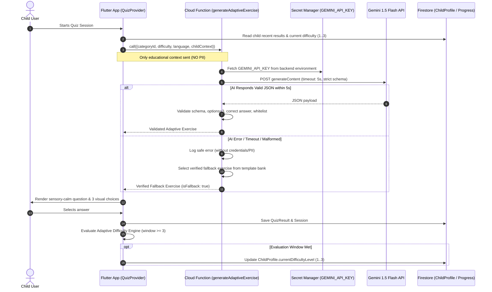

# Week 12: AI Integration and Adaptive Learning
**GenAI Adaptive Learning Assistant for Children with Autism Spectrum Disorder (ASD)**

---

## 1. Executive Summary

During **Week 12**, we integrated secure serverless Artificial Intelligence (GenAI/NLP) exercise generation and an explainable, deterministic adaptive difficulty engine into the application. 

The architecture strictly adheres to the mandated security constraint:
$$\text{Flutter} \longrightarrow \text{Cloud Functions} \longrightarrow \text{AI API (Gemini/NLP)} \longrightarrow \text{Cloud Functions} \longrightarrow \text{Flutter}$$

**Zero AI API keys or backend model secrets exist within the client application.** Furthermore, the system enforces child safety and data minimization, guaranteeing that personally identifiable information (parent email, child name, auth tokens) is never transmitted to the external AI model. When the AI service encounters network latency, rate limits, timeouts, or schema deviations, a sensory-calm predefined fallback mechanism guarantees uninterrupted learning for the child.

---

## 2. AI Architecture



---

## 3. Supported AI Exercises

All exercises are strictly bounded to the ASD educational vocabulary domains (**Letters**, **Numbers**, **Colors**, **Animals**) and adhere to the established 3-image visual choice format:

| Exercise Type | Description | Difficulty Level | Example (English) | Example (Arabic) |
|---|---|---|---|---|
| **Identify an Item** (`identify_item`) | Child identifies the vocabulary item by name/prompt. | Easy (Level 1) | *"Which one is the Cat?"* | *"أين هي القطة؟"* |
| **Select Correct Image** (`select_image`) | Visual recognition matching a prompt to one of 3 image cards. | Medium (Level 2) | *"Find the color Blue"* | *"اختر اللون الأزرق"* |
| **Match Word with Image** (`match_word`) | Associates vocabulary written word with corresponding image. | Medium / Hard (Level 2–3) | *"Look at the word: Dog. Pick the picture."* | *"انظر إلى الكلمة: كلب. اختر الصورة."* |
| **Choose Between Items** (`choose_item`) | Comparative or multi-attribute selection from vocabulary pool. | Hard (Level 3) | *"Which animal says meow?"* | *"أي حيوان يموء؟"* |

All answer options strictly enforce:
1. Exactly **3 distinct options**.
2. Valid image asset URLs/identifiers originating from our verified vocabulary catalog (`assets/images/vocabulary/...`).
3. Explicit identification of the single `correctAnswerId`.

---

## 4. Multi-Layer Validation Mechanism

Every AI-generated response passes through two validation gates (Cloud Function backend + Flutter client service) before reaching the child's screen:

```mermaid
graph TD
    A[AI Response String] --> B[Parse JSON]
    B --> C{Required Fields Present?}
    C -- No --> R[REJECT & TRIGGER FALLBACK]
    C -- Yes --> D{Language Matches Session?}
    D -- No --> R
    D -- Yes --> E{Options Count == 3?}
    E -- No --> R
    E -- Yes --> F{Correct Answer in Options?}
    F -- No --> R
    F -- Yes --> G{Difficulty in [1, 2, 3]?}
    G -- No --> R
    G -- Yes --> H{Vocabulary IDs in Whitelist?}
    H -- No --> R
    H -- Yes --> P[ACCEPT & DISPLAY TO CHILD]
```

### Validation Rules:
1. **Schema Integrity:** Ensures presence of `questionId`, `questionText`, `exerciseType`, `difficulty`, `options`, `correctAnswerId`, `language`, and `explanation`.
2. **Cardinality:** Exactly 3 options required for sensory simplicity (preventing cognitive overload in ASD children).
3. **Correct Answer Consistency:** The `correctAnswerId` must match one of the three options.
4. **Vocabulary Whitelist:** All `vocabularyId` values must belong to the approved vocabulary catalog (`cat`, `dog`, `bird`, `lion`, `red`, `blue`, `green`, `yellow`, `one`, `two`, `three`, `four`, `a`, `b`, `c`, `d`, etc.). Unvetted arbitrary external words are rejected immediately.
5. **Language Parity:** An English session rejects Arabic text responses; an Arabic session rejects English text responses.

---

## 5. Fallback Mechanism (Graceful Degradation)

The project risk assessment highlights AI outages, network latency, and non-deterministic formatting as critical risks for neurodivergent learners who require predictability and stability.

### Fallback Triggers:
- Backend timeout exceeding 5 seconds (`AbortController`).
- Client HTTP timeout exceeding 7 seconds.
- JSON parsing failure or schema validation failure.
- AI rate-limiting (HTTP 429) or quota exhaustion.
- Device operating in offline / airplane mode.

### Behavior:
1. Backend or client instantly retrieves an offline verified exercise from the curated question repository matching the requested category, language, and difficulty.
2. The user experience remains seamless: no alarming error popups, no red warning alerts, and zero interruption to the session flow.
3. The response carries `isFallback: true` and `provider: 'fallback_template'` for telemetry and monitoring.

---

## 6. Adaptive Difficulty Engine

The adaptive difficulty system uses deterministic, rule-based algorithms rather than unstable, arbitrary shifts:

### Supported Levels:
- **Level 1 (Easy):** Basic identification, high visual contrast, familiar single concepts.
- **Level 2 (Medium):** Bilingual matching, 3-option discrimination, broader vocabulary pool.
- **Level 3 (Hard):** Word-to-image matching, abstract prompts, multi-category reinforcement.

### Progression / Regression Matrix:

| Performance Condition | Accuracy Range | Action Taken | Rationale |
|---|---|---|---|
| **High Performance** | $\text{Accuracy} \ge 85\%$ | $\min(\text{Current} + 1, 3)$ | Ready for cognitive expansion without frustration. |
| **Stable Performance** | $60\% \le \text{Accuracy} < 85\%$ | Maintain $\text{Current}$ | Consolidation of mastered concepts. |
| **Low Performance** | $\text{Accuracy} < 60\%$ | $\max(\text{Current} - 1, 1)$ | Sensory relief, prevents frustration, revisits core concepts. |

### Evaluation Window Gating:
- **Minimum Data Requirement:** Difficulty adjustments occur only when at least **3 completed exercise/quiz results** are recorded in the evaluation window.
- **Single-Mistake Immunity:** A single accidental tap does **not** demote the child's difficulty level.
- **Personalized Recommendations:** If a child exhibits accuracy $< 60\%$ in a specific category (e.g., *Colors*), the system marks that category for reinforcement (`recommendedFocusCategory`). If performance in *Animals* exceeds $85\%$, the system recommends progressing to higher animal difficulty.

---

## 7. Security and Credential Protection

```text
[Flutter Client]
       │  (No API keys stored in client source or assets)
       ▼  (Callable HTTPS function with Firebase Auth context)
[Google Cloud Functions v2]
       │  (Accesses GEMINI_API_KEY via Secret Manager / environment)
       ▼
[Gemini Generative AI API]
```

### Verification:
1. Automated unit test `test/ai_adaptive_learning_test.dart` scans all Flutter client source code and assets.
2. **Zero** generative AI API keys (`GEMINI_API_KEY`, `OPENAI_API_KEY`, `sk-...`, `sk-ant-...`) exist in the Flutter codebase.
3. Secret keys are loaded on Google Cloud Functions servers via `process.env.GEMINI_API_KEY`.
4. Firebase App Client ID in `firebase_options.dart` is restricted to Firebase Auth/Firestore/Storage client SDK operations and cannot be used to call AI models directly.

---

## 8. Child Privacy & Data Minimization

In compliance with COPPA, GDPR-K, and ethical AI standards:

### Information NEVER Sent to AI:
- Child name or nickname.
- Child date of birth or age.
- Parent name, email, or telephone number.
- User passwords, hashes, or credentials.
- Firebase Auth tokens or session cookies.
- Device identifiers or IP addresses.

### Information Sent to AI (Minimal Educational Context):
- Target Category (`animals`, `colors`, `numbers`, `letters`).
- Current Difficulty Level (`1`, `2`, or `3`).
- Language Code (`ar` or `en`).
- Exercise Type (`identify_item`, `select_image`, `match_word`, `choose_item`).
- Performance Context (`high`, `stable`, `low`, recent accuracy percentage).
- Permitted Vocabulary Whitelist (array of 3–6 vocabulary tokens).

---

## 9. Safe Backend Logging

Backend logs in `functions/index.js` use structured JSON logging:
- Logs function start, elapsed duration, response category, difficulty, and fallback activation.
- Errors are sanitized: stack traces or raw AI responses containing unexpected tokens are caught and masked.
- API keys, credentials, and user IDs are never logged.

---

## 10. Automated Test Results

A dedicated test suite `test/ai_adaptive_learning_test.dart` provides 25 unit and widget tests covering all Week 12 requirements:

```text
00:12 +176: All tests passed!
```

### Breakdown of Week 12 Test Cases:
1. **Security & Privacy:**
   - Client source code verified free of AI API keys.
   - Child profile data sanitization verifies zero PII in AI payload.
2. **AI Exercise Generation & Validation:**
   - Valid JSON generation matching schema.
   - Rejection of missing required fields.
   - Rejection of invalid choice count ($\ne 3$).
   - Rejection of mismatched `correctAnswerId`.
   - Rejection of non-whitelisted arbitrary vocabulary IDs.
3. **Graceful Fallback:**
   - 5-second simulated AI timeout triggers predefined fallback.
   - Server 500 error triggers predefined fallback.
   - Malformed JSON string triggers predefined fallback.
   - Offline mode produces valid 3-choice exercise.
4. **Adaptive Difficulty Engine:**
   - High accuracy ($\ge 85\%$) increments difficulty.
   - Stable accuracy ($60\% - 84\%$) maintains difficulty.
   - Low accuracy ($< 60\%$) decrements difficulty.
   - Boundary enforcement (Level 1 cannot drop below 1; Level 3 cannot exceed 3).
   - Window gating (fewer than 3 results prevents premature change).
   - Category recommendations (struggles with Colors recommends Colors focus).
   - Child profile persistence updates Firestore `currentDifficultyLevel`.
5. **Quiz Flow Integration:**
   - QuizProvider dynamically loads AI-generated exercises.
   - QuizProvider records answers, computes updated child difficulty, and saves to repository.
6. **Bilingual RTL / LTR Support:**
   - Arabic session generates Arabic question prompt with RTL text direction.
   - English session generates English question prompt with LTR text direction.

---

## 11. Modified and Created Files

| File | Status | Description |
|---|---|---|
| `functions/index.js` | Updated | Implemented `generateAdaptiveExercise` Cloud Function v2 with timeout, schema validation, whitelist, fallback bank, and safe logging. |
| `lib/services/adaptive_difficulty_service.dart` | **New** | Pure, deterministic adaptive difficulty engine with boundary enforcement, window gating, and category recommendations. |
| `lib/services/ai_adaptive_service.dart` | **New** | Client service interfacing with Cloud Function, enforcing schema validation, 7s timeout, and offline fallback. |
| `lib/repositories/user_repository.dart` | Updated | Added `getChildById` and `updateChildDifficulty` to `UserRepository` and `BaseUserRepository`. |
| `lib/providers/quiz_provider.dart` | Updated | Added `startAdaptiveQuizSession`, AI exercise retrieval, adaptive difficulty evaluation on finish, and child profile updates. |
| `lib/screens/child/quiz_screen.dart` | Updated | Added `useAi` parameter, adaptive difficulty evaluation card on completion, and integration with `AiAdaptiveService`. |
| `lib/services/firebase_service.dart` | Updated | Added `testAdaptiveExerciseFunction` helper for diagnostics. |
| `test/ai_adaptive_learning_test.dart` | **New** | 25 automated unit/integration tests verifying Week 12 implementation. |
| `test/auth_and_user_management_test.dart` | Updated | Updated `FakeUserRepository` to support `getChildById` and `updateChildDifficulty`. |
| `Docs/WEEK12_AI_ADAPTIVE_LEARNING.md` | **New** | Comprehensive Week 12 architecture and milestone report. |

---

## 12. Remaining Scope & Exclusions

In accordance with project guidelines:
- **Speech recognition** is excluded (reserved for future voice iterations).
- **Wearable sensor integration** is excluded (hardware-independent software focus).
- **Custom ML model training** on client devices is excluded (serverless GenAI API + deterministic heuristics used instead).
- Existing controlled quizzes remain the primary backbone; AI enriches and adapts them dynamically rather than creating an unconstrained conversational chatbot.

---

## 13. Readiness for Week 13

The application is **100% ready for Week 13 (Full Integration Testing & System Hardening)**:
- All 176 project tests pass with zero regressions.
- Cloud Functions syntax verified (`node -c functions/index.js` exit code 0).
- Bilingual RTL/LTR layout maintained across all screens.
- Security and privacy controls fully in place.
