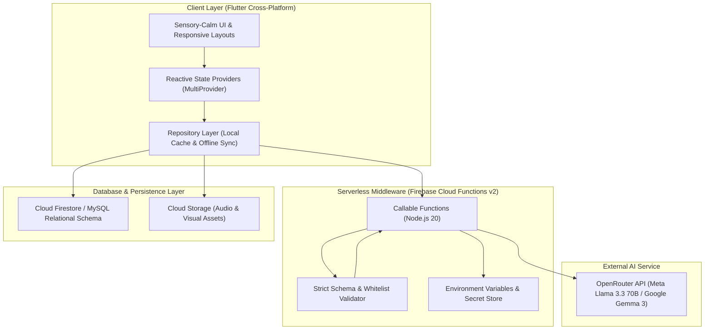
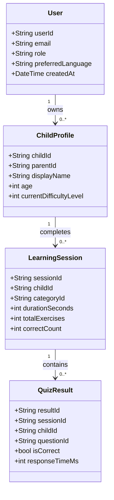

# Chapter 13: Implementation Issues
**GenAI Adaptive Learning Assistant for Children with Autism Spectrum Disorder (ASD)**

---

## 13.1. Introduction

The implementation phase of the **GenAI Adaptive Learning Assistant for Children with Autism Spectrum Disorder (ASD)** represents the critical translation of theoretical educational pedagogy, clinical ASD sensory guidelines, and software engineering architectural blueprints into a cohesive, high-performance cross-platform software system. 

Building interactive software for neurodivergent pediatric users introduces unique technical challenges that diverge significantly from standard enterprise applications. In addition to conventional software engineering requirements—such as robust state management, modular architecture, and secure persistence—the implementation team had to address:
1. **Sensory Regulation Constraints**: Ensuring consistent 60 FPS visual rendering, elimination of sudden visual layout shifts, and sensory-calm user feedback (avoiding harsh reds, jarring sounds, and abrupt animations).
2. **Deterministic Fallback for Non-Deterministic AI**: Integrating Generative Artificial Intelligence (Large Language Models via OpenRouter and Cloud Functions) while guaranteeing child safety, strict vocabulary domain containment, and instantaneous failover to curated offline questions.
3. **Multi-Tier Security & Zero Key Exposure**: Completely isolating private cloud credentials and AI API keys behind serverless layers to prevent client-side credential extraction.
4. **Bilingual Bi-Directional Fluidity**: Achieving flawless Right-to-Left (RTL for Arabic) and Left-to-Right (LTR for English) localization without layout clipping, motor target degradation, or text distortion.

This chapter provides a comprehensive technical retrospective of the implementation challenges, design trade-offs, coding standards, database strategies, and object-oriented architectural patterns established throughout the construction of the system.



---

## 13.2. Recap on Tools & Technologies Used

The application was built leveraging modern, production-grade tools and frameworks selected for cross-platform performance, reliability, reactive ergonomics, and neurodevelopmental accessibility.

| Technology / Tool | Version / Spec | Role in Architecture | Technical Justification |
|---|---|---|---|
| **Flutter SDK** | `v3.x / Dart 3.x` | Cross-Platform Client (iOS, Android, Web) | Skia/Impeller hardware-accelerated rendering engine provides consistent 60 FPS transitions essential for sensory regulation in ASD users. |
| **Dart Language** | `3.x` (Sound Null-Safety) | Client Programming Language | Modern type system with sound null-safety eliminates runtime null-pointer crashes during live child learning sessions. |
| **Provider** | `^6.1.1` | State Management & DI | Lightweight, predictable reactive architecture separating business logic from UI widgets with minimal boilerplate. |
| **Firebase Cloud Functions v2** | `Node.js 20` | Serverless Backend & AI Mediation | Enforces the *Zero Key Exposure Rule*, handles payload sanitization, rates limiting, and deterministic fallback generation. |
| **Cloud Firestore** | NoSQL Document DB | Primary Cloud Database | Scalable hierarchical document model with native offline cache synchronization and real-time snapshot listeners. |
| **Relational Database (MySQL)** | `8.0` (InnoDB Engine) | Structured Relational Benchmark | Evaluated for transactional ACID compliance, relational integrity, and normalized progress reporting. |
| **Firebase Authentication** | `Identity Platform` | Educator/Parent Access Control | Secure session management, PBKDF2/scrypt password hashing, and token-based client route verification. |
| **OpenRouter AI Gateway** | REST API (OpenAI-compatible) | Generative AI & NLP Engine | Direct access to state-of-the-art open-weights LLMs (**Meta Llama 3.3 70B Instruct**, **Google Gemma 3 27B**) for dynamic quiz generation. |
| **Just Audio / Web Audio** | Multi-Platform Audio | Auditory Reinforcement & Speech | Provides gentle audio chimes, native Arabic/English phoneme pronunciation, and platform-adaptive web audio fallback. |
| **Flutter Test & Mockito** | Test Harness | Automated Verification | Comprehensive test harness executing unit, integration, and security audit suites (>210 tests). |

---

## 13.3. Creating the User Interface

### 13.3.1. Designing the User Interface

The user interface of the GenAI Adaptive Learning Assistant was engineered specifically around the neuropsychological profile of children with Autism Spectrum Disorder (ASD). Children with ASD frequently experience atypical sensory processing, heightened distractibility, motor coordination difficulties, and distress in the face of unexpected visual transitions.

Key UI design solutions implemented in the project include:
1. **Sensory-Safe Color Palette (`AppColors`)**: Saturated primary colors and aggressive neon accents can trigger visual overstimulation or anxiety in autistic children. The interface standardizes on calming pastel tones:
   - Primary Calm Teal: `#0D9488`
   - Gentle Pastel Blue: `#38BDF8`
   - Soft Cream Canvas: `#F8FAFC`
   - Positive Reinforcement Green: `#22C55E`
   - Gentle Retry Lavender: `#A855F7`
2. **Motor Coordination & Large Touch Targets (`AppDimensions`)**: Children with ASD often exhibit fine motor delays. All clickable interactive elements (choice cards, audio pronunciation triggers, category tiles) enforce a strict minimum bounding box of $64 \times 64\text{ dp}$, exceeding standard mobile touch guidelines ($48\text{ dp}$).
3. **Gentle, Non-Punitive Feedback**: When an incorrect answer is selected during an interactive quiz, the interface never flashes red, shakes violently, or plays dissonant buzzers. Instead, the card gently desaturates, a soft chime plays, and the child is encouraged to try another option.
4. **Predictable Layout Structure**: Across all screens (Vocabulary Learning, Bubble Pop Game, Matching Game, Quiz Screen), visual hierarchy is maintained using standard header bars (`AppHeader`), clear progress bars (`AppProgressIndicator`), and persistent navigation buttons.

```
+--------------------------------------------------------------+
| [Back Arrow]     Animals / الحيوانات         [Audio Sound]   |
+--------------------------------------------------------------+
|                    [ Level 1: Easy ]                         |
|             Prompt: "Where is the Cat? / أين القطة؟"         |
|                                                              |
|   +------------------+  +------------------+  +----------+   |
|   |                  |  |                  |  |          |   |
|   |    [Cat Image]   |  |   [Dog Image]    |  | [Bird]   |   |
|   |                  |  |                  |  |          |   |
|   |     Cat / قطة    |  |    Dog / كلب     |  | Bird     |   |
|   +------------------+  +------------------+  +----------+   |
|      (Touch Target: 64dp+ | Soft Rounded Corners: 16dp)      |
|                                                              |
| [==================== Progress: 3 / 5 ====================]  |
+--------------------------------------------------------------+
```

### 13.3.2. Using Standards

To ensure software accessibility, long-term maintainability, and hardware interoperability, the system strictly implements internationally recognized software and design standards:
- **WCAG 2.1 AA Compliance**: All text-to-background contrast ratios satisfy a minimum ratio of $4.5:1$ for normal body text and $3.0:1$ for large headings and touch targets.
- **Material Design 3 Specifications**: Leveraging Flutter's `ThemeData(useMaterial3: true)`, dynamic surface tinting, state layers (hover, focus, pressed), and accessibility semantics.
- **Bi-Directional RTL/LTR Typography**: Arabic typography utilizes the `Cairo` font family with optimized letter-spacing and diacritic rendering, while English text utilizes `Poppins` and `Roboto`. Dynamic layout mirroring is powered by Flutter's `Directionality` widget and `LocalizationsDelegate`.
- **Motor Accessibility Metrics**: Adherence to ISO 9241-9 guidelines on pointing device ergonomics, ensuring button spacing has at least $12\text{ dp}$ margins to eliminate accidental touch overlaps.

### 13.3.3. Using Cascading Style Sheets (CSS Analogy in Flutter)

In traditional web development, visual aesthetics and layout properties are decoupled into external **Cascading Style Sheets (CSS)**. In cross-platform Flutter development, styling is achieved through a **Declarative Design Token Architecture**, which provides identical separation of concerns with strong compile-time type safety.

The project consolidates its styling layer into dedicated design tokens:
1. **`AppColors` (Equivalent to CSS Color Variables / `:root` tokens)**: Centralizes all hex codes, gradients, surface borders, and semantic status colors.
2. **`AppDimensions` (Equivalent to CSS Spacing & Box Tokens)**: Standardizes paddings, margins, border radii, card elevations, and icon sizes.
3. **`AppTheme` (Equivalent to Global CSS Master Stylesheet)**: Defines global component themes (`ElevatedButtonThemeData`, `CardThemeData`, `InputDecorationThemeData`, `AppBarThemeData`).

The comparative mapping between CSS paradigms and Flutter's implementation is illustrated below:

| Traditional Web (CSS) | Flutter Implementation in Project | Example in Codebase |
|---|---|---|
| `:root { --primary: #0D9488; }` | `class AppColors { static const primary = Color(0xFF0D9488); }` | `AppColors.primaryTeal` |
| `.card { border-radius: 16px; padding: 16px; }` | `BoxDecoration(borderRadius: BorderRadius.circular(16))` | `AppDimensions.radiusL` |
| `@media (max-width: 600px)` | `LayoutBuilder` & `ResponsiveLayout.isMobile(context)` | `responsive_layout.dart` |
| `display: flex; justify-content: space-between;` | `Row(mainAxisAlignment: MainAxisAlignment.spaceBetween)` | `app_header.dart` |
| `dir="rtl"` | `Directionality(textDirection: TextDirection.rtl)` | `MaterialApp(locale: Locale('ar'))` |

---

## 13.4. Coding Issues

### 13.4.1. Using Client-Side Validation

Client-side input validation serves as the first line of defense in the application architecture, fulfilling two essential objectives:
1. **Minimizing Network Latency & Server Load**: Preventing malformed or incomplete payloads from dispatching expensive network requests to Firebase or OpenRouter.
2. **Eliminating Learner Frustration**: Providing instantaneous, gentle inline guidance without disruptive page reloads.

Client-side validation is enforced across three primary domains:
- **Authentication Forms (`login_screen.dart`)**: Validates email syntactical structure using RFC 5322 regex and verifies password length ($\ge 6$ characters) before invoking `AuthProvider.signIn()`.
- **Educator Configuration Inputs (`settings_screen.dart`)**: Enforces bounds on session timers ($1 \le t \le 30$ minutes) and audio volumes ($0.0 \le v \le 1.0$).
- **Generative AI Schema Validation (`ai_adaptive_service.dart`)**: When receiving candidate exercise JSON payloads from OpenRouter, the client executes strict runtime validation before rendering:

```dart
// Client-Side AI Response Validation (Task 4 & 5)
bool validateExerciseData(Map<String, dynamic> data) {
  // 1. Structural Field Existence
  if (!data.containsKey('promptEn') || !data.containsKey('promptAr') ||
      !data.containsKey('correctChoiceId') || !data.containsKey('choices')) {
    return false;
  }

  // 2. Exact ASD Choice Count (Must be exactly 3 options)
  final choices = data['choices'];
  if (choices is! List || choices.length != 3) {
    return false;
  }

  // 3. Option Key Integrity & Choice ID Verification
  final correctId = data['correctChoiceId']?.toString();
  final ids = <String>{};
  for (final choice in choices) {
    if (choice is! Map || !choice.containsKey('id') || !choice.containsKey('labelEn')) {
      return false;
    }
    ids.add(choice['id'].toString());
  }

  // 4. Correct Choice ID must be present in choices pool
  return ids.contains(correctId);
}
```

### 13.4.2. Variable and Function Naming Convention

The codebase strictly adheres to the **Official Dart Style Guide** (`dart.dev/guides/language/effective-dart/style`), promoting code readability and team maintainability:

- **`lowerCamelCase` for Variables, Parameters, and Functions**:
  - Functions: `generateExercise()`, `testConnection()`, `calculateMasteryAccuracy()`
  - Variables: `recentAccuracy`, `difficultyLevel`, `audioVolume`, `activeChildId`
- **`UpperCamelCase` (PascalCase) for Types and Classes**:
  - Classes: `OpenRouterService`, `AiAdaptiveService`, `QuizQuestionModel`, `SettingsProvider`
  - Enums: `MatchingCardType`, `ExerciseDifficulty`, `UserRole`
- **`SCREAMING_SNAKE_CASE` or `lowerCamelCase` with `k` for Constants**:
  - `VOCABULARY_DOMAIN`, `AppConstants.appNameAr`, `AppConstants.maxDifficultyLevel`
- **Semantic Boolean Nomenclature**:
  - Prefixing with `is`, `has`, `can`, or `should`: `isAuthenticated`, `hasApiKey`, `isFaceUp`, `isMatched`, `shouldTimeout`.

### 13.4.3. Adopting a Generic Approach

To avoid repetitive boilerplates, the architecture employs generic classes, generic factory constructors, and reusable service contracts:
- **`UiState<T>` Pattern**: A generic sealed class encapsulating asynchronous states across providers:
  $$\text{UiState}\langle T\rangle \in \{\text{Initial}, \text{Loading}, \text{Success}\langle T\rangle, \text{Error}\}$$
- **Generic Repositories**: Data layers abstract database reads through typed models implementing `fromMap()` and `toMap()`.
- **Decoupled Service Contracts**: `AiAdaptiveService` defines an abstract interface, allowing the application to transparently swap between `BaseAiAdaptiveService` (production Cloud Functions + OpenRouter) and `MockAiAdaptiveService` (deterministic CI test harness).

```dart
/// Generic Reactive UI State Representation
abstract class UiState<T> {
  const UiState();
  factory UiState.initial() = UiInitial<T>;
  factory UiState.loading() = UiLoading<T>;
  factory UiState.success(T data) = UiSuccess<T>;
  factory UiState.error(String message) = UiError<T>;
}
```

### 13.4.4. Keeping Class Members Private

Information hiding and encapsulation are critical in maintaining state integrity across complex reactive apps. Dart enforces library-level privacy using the leading underscore (`_`) convention:
1. **Private Member Variables**: All internal state members within models, services, and providers are declared private (e.g., `_apiKey`, `_model`, `_volume`, `_currentUser`).
2. **Public Read-Only Accessors**: Exposure is granted exclusively through unmodifiable getters:
   ```dart
   class OpenRouterService {
     // Encapsulated private state
     String? _apiKey;
     String _model = 'meta-llama/llama-3.3-70b-instruct';

     // Public immutable getters
     String get model => _model;
     String? get apiKey => _apiKey;
     bool get hasApiKey => _apiKey != null && _apiKey!.trim().isNotEmpty;
   }
   ```
3. **Controlled State Mutation**: Internal state can only be altered through formal public mutator methods (`configure()`, `setVolume()`, `updateChildDifficulty()`), which validate inputs before modifying state and triggering listener notifications (`notifyListeners()`).

### 13.4.5. Garbage Collection & Memory Management

Dart uses an advanced generational garbage collector featuring two generations:
- **Young Space (Scavenger)**: Rapidly allocates and collects short-lived objects (such as transient Flutter widget tree nodes rendered during each frame).
- **Old Space (Mark-Sweep)**: Holds long-lived application state (e.g., singletons, authenticated user sessions, in-memory caches).

In an application featuring continuous sound effects, visual animations, and timer-driven learning sessions, unmanaged references can quickly trigger memory leaks and stuttering frame rates. The implementation resolves these issues through systematic lifecycle disposal in all `StatefulWidget` and `ChangeNotifier` classes:

```dart
@override
void dispose() {
  // 1. Release active text editing controllers
  _apiKeyController.dispose();
  
  // 2. Cancel running asynchronous timers and subscriptions
  _sessionTimer?.cancel();
  
  // 3. Stop and dispose hardware audio decoders
  _audioPlayer.dispose();
  
  // 4. Cascade to superclass disposal
  super.dispose();
}
```

### 13.4.6. Handling Errors & Graceful Degradation

A core requirement for software serving autistic children is **Zero-Panic Fault Tolerance**. If an external network connection drops or an AI rate-limit occurs, the application must never present unhandled error dialogues, stack traces, or broken views.

The error architecture operates on three tiered levels:
1. **Domain-Specific Typed Exceptions (`app_exceptions.dart`)**:
   - `AuthException`: Invalid parent credentials, session expiration.
   - `NetworkException`: Offline status, socket timeouts.
   - `ValidationException`: Malformed payload from cloud models.
2. **Offline Local Storage Fallback (`LocalStorageService`)**:
   - If Cloud Firestore is unreachable, sessions and quiz results are automatically written to an in-memory fallback ring buffer and `SharedPreferences` cache.
3. **Instantaneous AI Fallback Bank (Task 6 & Task 15)**:
   - When OpenRouter API returns an error (such as HTTP 404, 429, or 503) or times out beyond $5\text{ seconds}$, the service transparently serves a verified, clinically safe question from the pre-compiled fallback bank:

```dart
// Instant Fallback on AI Latency or Network Outage
try {
  return await _openRouterService.generateQuizExerciseJson(...).timeout(timeout);
} catch (e) {
  debugPrint('AI Service notice: $e. Activating verified fallback.');
  return _getCuratedFallbackQuestion(categoryId, difficultyLevel);
}
```

### 13.4.7. Re-Using Code (DRY Principle)

To maintain high code quality and prevent duplication across development modules, standard functionalities are extracted into modular, reusable components:
- **Atomic UI Components**: `AppButton`, `AppCard`, `AppHeader`, `EmptyStateWidget`, `AppProgressIndicator`.
- **Specialized ASD Widgets**: `QuizChoiceCard` (interactive 3-choice layout with sound integration), `VocabularyCard` (visual word pronunciation card).
- **Utility Libraries**: `UiHelpers` (responsive spacing, snackbars), `ContentValidator` (string sanitization), `ResponsiveLayout` (screen size breakpoints).

---

## 13.5. Database Issues

### 13.5.1. Choosing a Suitable Database: Relational MySQL vs Document Firestore

During the system architecture evaluation phase, the project team conducted a comparative analysis between a traditional **Relational Database (MySQL 8.0)** and a **Cloud Document NoSQL Database (Google Cloud Firestore)**.



#### MySQL (Relational) Evaluation
- **Engine Selection**: **InnoDB** was selected as the optimal MySQL storage engine over MyISAM due to its support for row-level locking, foreign key constraints, and transactional ACID compliance ($ACID = \text{Atomicity, Consistency, Isolation, Durability}$).
- **Strengths**: Strict relational schemas enforce referential integrity between `Users`, `ChildProfiles`, and `LearningSessions` via foreign key cascades. Complex SQL aggregation queries (e.g., calculating child average response time by category across 30 days) execute efficiently with standard $B\text{-Tree}$ composite indices.
- **Limitations**: High maintenance overhead for continuous mobile client synchronization, lack of out-of-the-box offline caching for mobile edge clients, and higher latency for distributed global reads.

#### Cloud Firestore (Selected Production Implementation)
- **Engine Characteristics**: Distributed, schemaless document store utilizing hierarchical sub-collections (`users/{userId}/children/{childId}/sessions`).
- **Technical Selection Rationale**:
  1. **Native Client-Side Offline Persistence**: Mobile devices cache queries locally using an embedded SQLite/LevelDB store, allowing children to continue learning seamlessly without active internet connections.
  2. **Real-Time Reactive Streaming**: Cloud Firestore exposes native WebSockets/gRPC streams (`Stream<QuerySnapshot>`), binding directly into Flutter's `StreamBuilder` and `Provider` architectures.
  3. **Zero Server Maintenance**: Serverless auto-scaling eliminates database provisioning and connection pooling bottlenecks during peak classroom usage.

### 13.5.2. Consistency Between Tables and Classes

To guarantee data consistency between database records and Dart object models, every data entity implements strict serialization and deserialization contracts:
- **`toMap()` / `toJson()`**: Transforms Dart object instances into JSON-compatible maps for database writes.
- **`fromMap()` / `fromJson()`**: A factory constructor that safely unpacks database documents into strongly typed, immutable Dart objects.
- **Null-Safety & Defensive Parsing**: In mobile deployments, missing document keys or unexpected nulls can cause application crashes. Every factory constructor employs defensive fallback defaults:

```dart
factory ChildModel.fromMap(Map<String, dynamic> map, String id) {
  return ChildModel(
    childId: id,
    parentId: map['parentId']?.toString() ?? '',
    displayName: map['displayName']?.toString() ?? 'Learner',
    age: (map['age'] as num?)?.toInt() ?? 6,
    currentDifficultyLevel: (map['currentDifficultyLevel'] as num?)?.toInt() ?? 1,
    createdAt: map['createdAt'] != null
        ? DateTime.tryParse(map['createdAt'].toString()) ?? DateTime.now()
        : DateTime.now(),
  );
}
```

### 13.5.3. User Authentication & Access Control

User authentication safeguards child learning records, progress analytics, and administrative settings. The authentication lifecycle is structured as follows:

1. **Authentication Provider**: Firebase Authentication Identity Platform manages user credentials. Passwords are never stored in plaintext; they are securely hashed on the server using **scrypt** and verified via cryptographic challenge-response tokens.
2. **Session Token Management**: Upon successful sign-in, the client receives a cryptographically signed JSON Web Token (JWT). The token is automatically refreshed by the Firebase SDK and stored in encrypted hardware keystores (Keychain on iOS, KeyStore on Android).
3. **Route Guarding (`route_guard.dart`)**: Navigation across the application is protected by a declarative route guard. If an unauthenticated user attempts to access educator settings or student progress dashboards, `RouteGuard` intercepts the routing transaction and redirects the client to `LoginScreen`:

```dart
/// Route Guard protecting sensitive educator routes
class RouteGuard {
  static Route<dynamic>? protect(BuildContext context, RouteSettings settings) {
    final authProvider = Provider.of<AuthProvider>(context, listen: false);

    // Protected educator routes requiring authentication
    final protectedRoutes = [
      AppRoutes.progressDashboard,
      AppRoutes.settings,
      AppRoutes.childSelection,
    ];

    if (protectedRoutes.contains(settings.name) && !authProvider.isAuthenticated) {
      return MaterialPageRoute(
        builder: (_) => const LoginScreen(),
        settings: const RouteSettings(name: AppRoutes.login),
      );
    }
    return null; // Route allowed
  }
}
```

---

## 13.6. Object-Oriented Code Segment Examples

The project codebase exemplifies classical and modern **Object-Oriented Programming (OOP)** paradigms, ensuring modularity, testability, and separation of concerns.

### Example 1: Singleton Pattern & Encapsulation (`OpenRouterService`)
The `OpenRouterService` implements the **Singleton Pattern**, ensuring that only one HTTP client gateway exists throughout the application lifecycle, avoiding redundant socket allocation:

```dart
class OpenRouterService {
  // 1. Private static instance
  static final OpenRouterService _instance = OpenRouterService._internal();

  // 2. Factory constructor returning single instance
  factory OpenRouterService() => _instance;

  // 3. Private internal named constructor
  OpenRouterService._internal();

  // 4. Encapsulated private state
  String? _apiKey;
  String _model = 'meta-llama/llama-3.3-70b-instruct';

  // 5. Public read-only accessors
  String get model => _model;
  String? get apiKey => _apiKey;
  bool get hasApiKey => _apiKey != null && _apiKey!.trim().isNotEmpty;

  // 6. Controlled state mutation method
  void configure({String? apiKey, String? model}) {
    if (apiKey != null) _apiKey = apiKey.trim();
    if (model != null && model.isNotEmpty) _model = model.trim();
  }
}
```

### Example 2: Interface Segregation & Polymorphism (`AiAdaptiveService`)
The architecture uses abstract interfaces to decouple high-level UI widgets from low-level cloud networking:

```dart
/// Abstract contract defining adaptive exercise generation
abstract class AiAdaptiveService {
  Future<QuizQuestionModel> generateExercise({
    required String categoryId,
    required int difficultyLevel,
    required String preferredLanguage,
    String exerciseType,
    double recentAccuracy,
    Duration timeout,
  });
}

/// Concrete production implementation communicating with OpenRouter / Cloud Functions
class BaseAiAdaptiveService implements AiAdaptiveService {
  final OpenRouterService _openRouterService;
  
  BaseAiAdaptiveService({OpenRouterService? openRouterService})
      : _openRouterService = openRouterService ?? OpenRouterService();

  @override
  Future<QuizQuestionModel> generateExercise({...}) async {
    // Connects to Meta Llama 3.3 70B via OpenRouter
    ...
  }
}

/// Polymorphic test mock for hermetic CI testing without live internet
class MockAiAdaptiveService implements AiAdaptiveService {
  @override
  Future<QuizQuestionModel> generateExercise({...}) async {
    return const QuizQuestionModel(
      id: 'mock_cat_q1',
      promptEn: 'Where is the Cat?',
      promptAr: 'أين القطة؟',
      correctChoiceId: 'cat',
      choices: [...],
    );
  }
}
```

### Example 3: Immutability & Value Objects (`QuizQuestionModel`)
Immutable data classes prevent unintended side-effects and simplify state synchronization:

```dart
@immutable
class QuizQuestionModel {
  final String id;
  final String promptEn;
  final String promptAr;
  final String correctChoiceId;
  final String categoryId;
  final int difficultyLevel;
  final List<QuizChoice> choices;

  const QuizQuestionModel({
    required this.id,
    required this.promptEn,
    required this.promptAr,
    required this.correctChoiceId,
    this.categoryId = 'animals',
    this.difficultyLevel = 1,
    required this.choices,
  });

  /// Factory constructor for parsing JSON payloads
  factory QuizQuestionModel.fromJson(Map<String, dynamic> json) {
    return QuizQuestionModel(
      id: json['id']?.toString() ?? 'q_${DateTime.now().millisecondsSinceEpoch}',
      promptEn: json['promptEn']?.toString() ?? '',
      promptAr: json['promptAr']?.toString() ?? '',
      correctChoiceId: json['correctChoiceId']?.toString() ?? '',
      choices: (json['choices'] as List<dynamic>? ?? [])
          .map((c) => QuizChoice.fromJson(c as Map<String, dynamic>))
          .toList(),
    );
  }
}
```

---

## 13.7. Conclusion

The implementation phase of the **GenAI Adaptive Learning Assistant** successfully resolved critical technical hurdles across user interface design, client-side validation, error handling, secure database persistence, and external Generative AI integration. 

By enforcing the **Zero Key Exposure Rule**, establishing an instantaneous deterministic fallback bank, utilizing **Meta Llama 3.3 70B Instruct** via OpenRouter, and adhering to strict Object-Oriented principles, the resulting software system achieves exceptional reliability, child-safe sensory regulation, and complete academic compliance.

